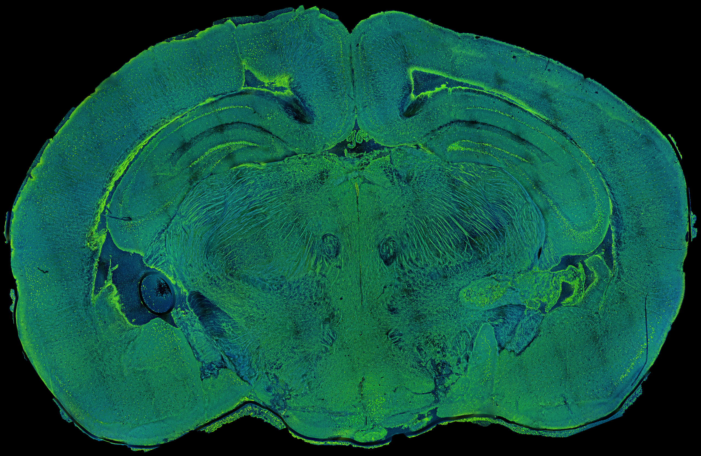
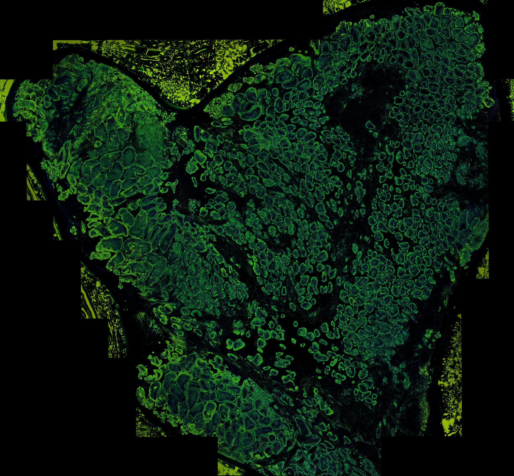
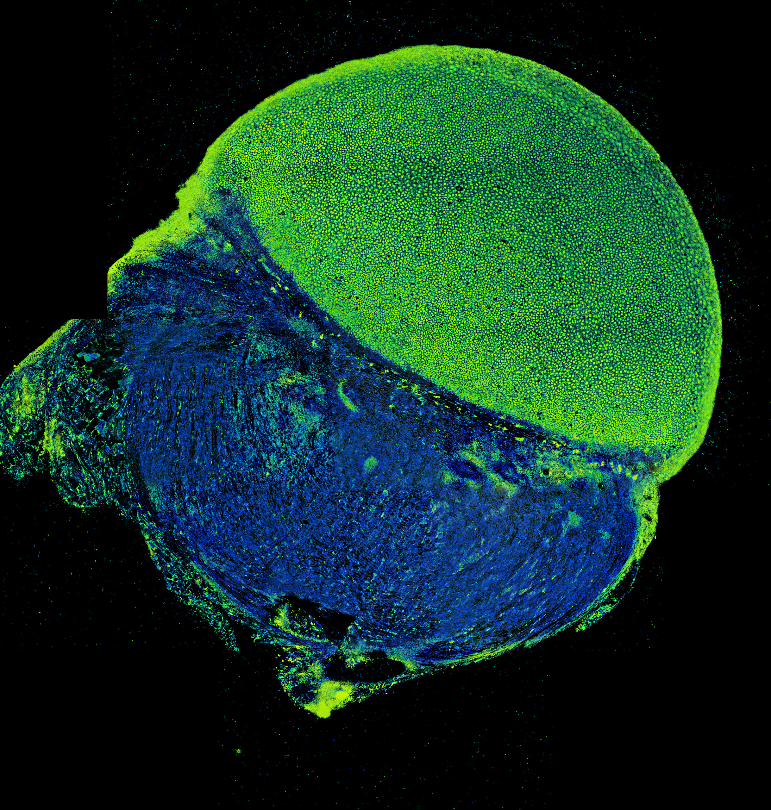
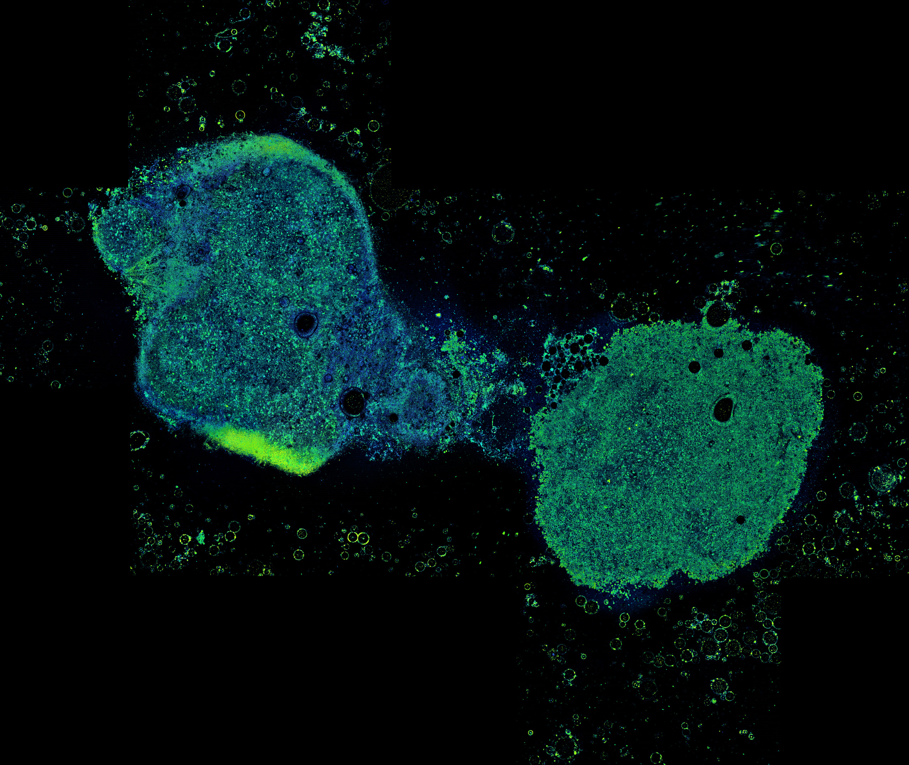
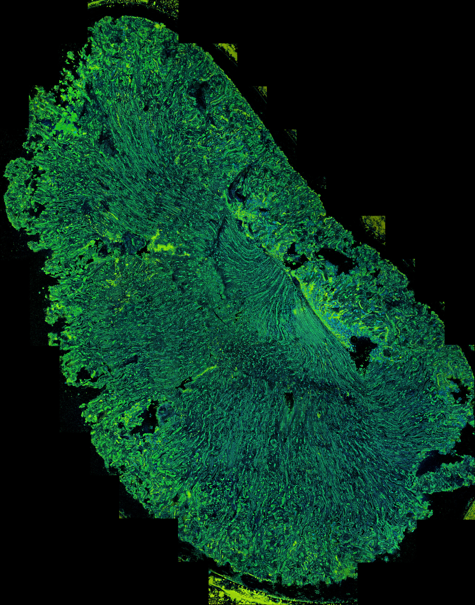
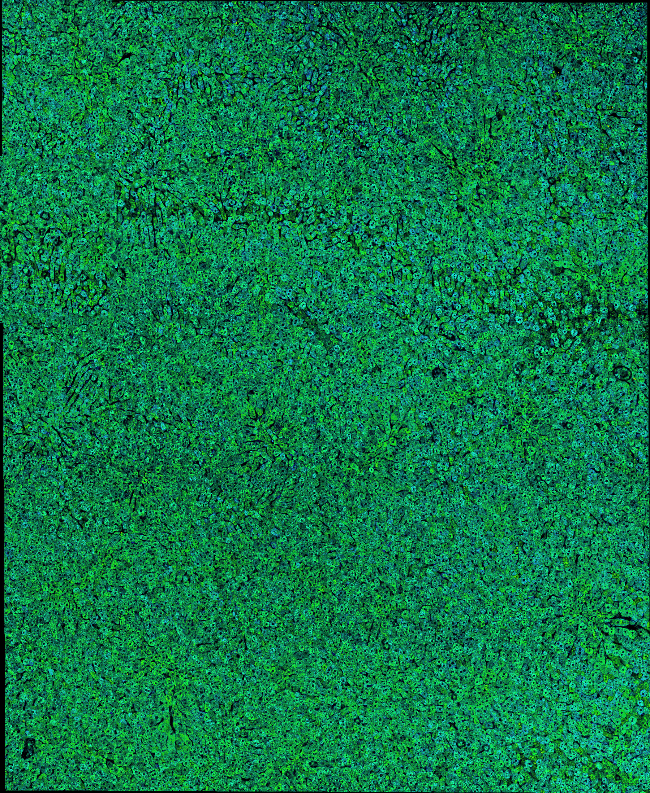
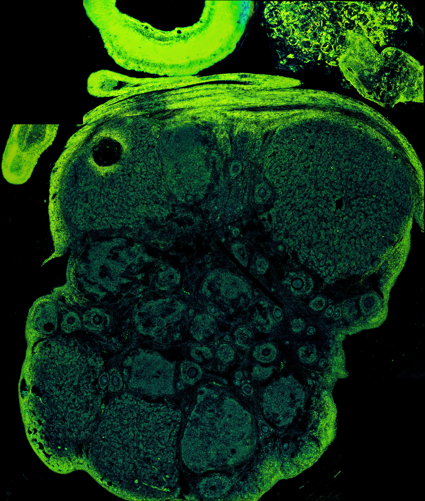
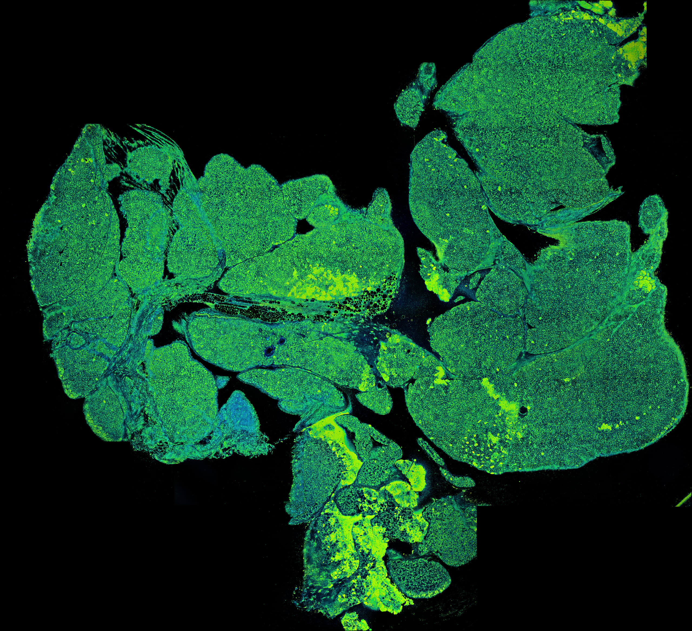
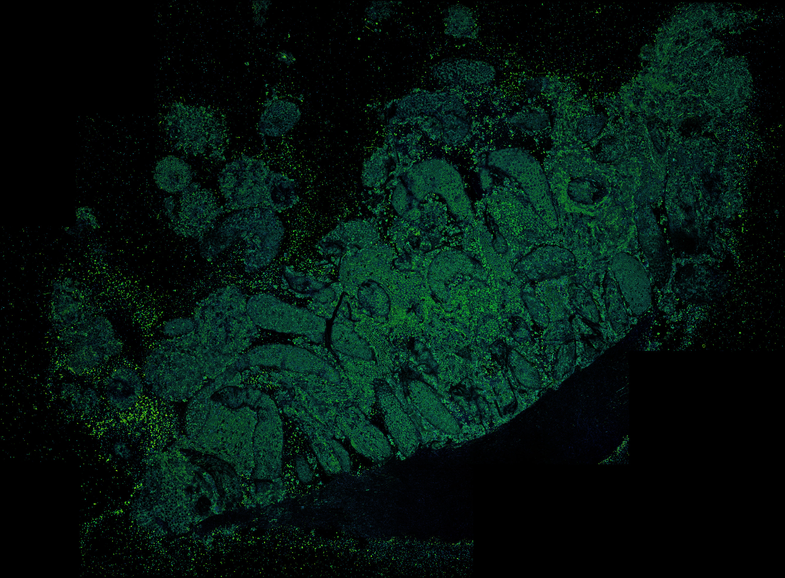
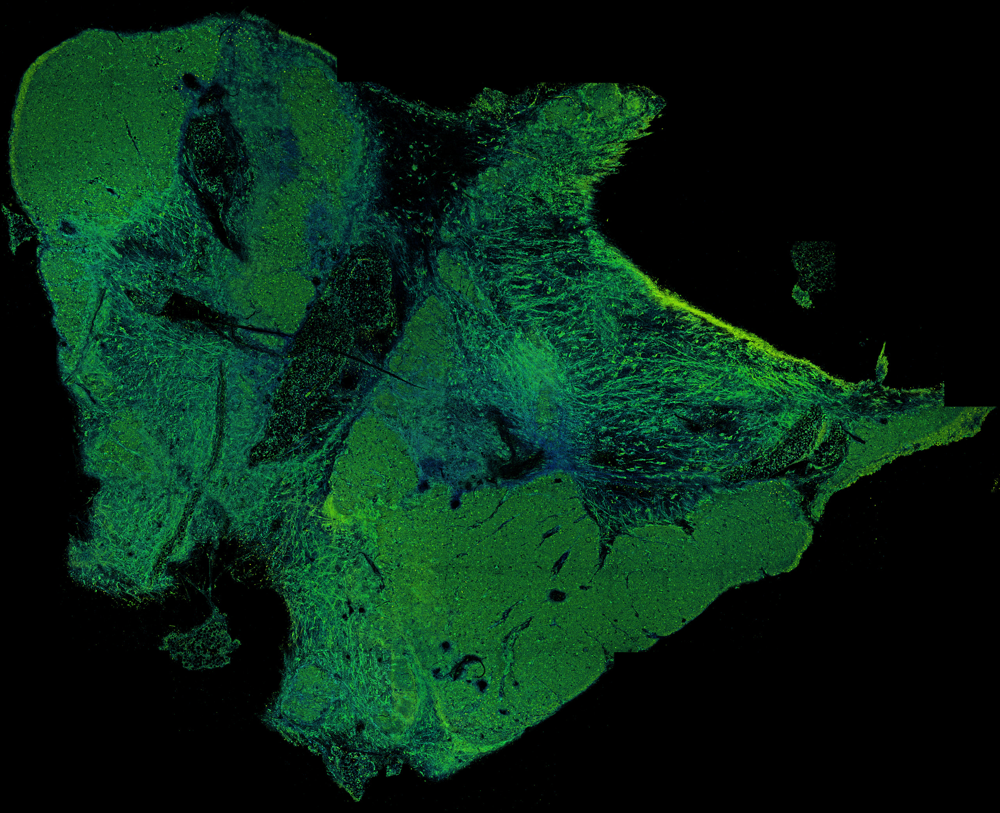

# Mouse organ dFFOCT data

Data accompanying the manuscript **Label-free volumetric dynamic atlas of fresh mouse organs using dynamic full-field optical coherence tomography** by Dr. Bin He.
**These data may be used only for non-commercial research purposes after the associated manuscript has completed peer review and been formally published. Commercial use is not permitted**.

[Supplementary videos](#supplementary-videos) · [Organ overview gallery](#organ-overview-gallery) · [Dataset contents](#dataset-contents) · [Download and restore](#download-and-restore) · [Citation and reuse](#citation-and-reuse)

Browse six supplementary videos and ten organ overview images below. The original imaging dataset contains 30 files; the six supplementary MP4 videos are provided separately.

## Supplementary videos

The six videos below accompany the manuscript. The original MP4 files are available through the download links; no resizing or re-encoding was applied to those repository copies. If an embedded player is unavailable, download the corresponding MP4 and play it locally. Video checksums and descriptions are recorded in [supplemental-videos/SHA256SUMS.txt](supplemental-videos/SHA256SUMS.txt) and [supplemental-videos/README.md](supplemental-videos/README.md).

### Visualization 1 — Whole mouse brain

Large-area D-FFOCT imaging of freshly excised mouse brain in the coronal plane. **Fig. 2(a).**

https://github.com/user-attachments/assets/bd3ee4df-0d4d-48f9-a91f-8721714a3331

[Download original MP4 — VideoS1-Whole Brain of Mouse.mp4](https://github.com/forest1997/mouse-organs-dffoct-raw-data/raw/refs/heads/main/supplemental-videos/VideoS1-Whole%20Brain%20of%20Mouse.mp4)

### Visualization 2 — Mouse brain in 3D

Three-dimensional D-FFOCT reconstruction of a hippocampal region in fresh mouse brain. **Fig. 2(d).**

https://github.com/user-attachments/assets/2365a067-2763-40dd-b462-17d578f771ae

[Download original MP4 — VideoS2-Mouse_Brain_3D.mp4](https://github.com/forest1997/mouse-organs-dffoct-raw-data/raw/refs/heads/main/supplemental-videos/VideoS2-Mouse_Brain_3D.mp4)

### Visualization 3 — Mouse eyeball in 3D

Three-dimensional D-FFOCT reconstruction of a corneal region in a fresh mouse eyeball. **Fig. 3(d).**

https://github.com/user-attachments/assets/5c7d6ccf-2373-47bb-b112-f18a69fdd7a2

[Download original MP4 — VideoS3-Mouse_Eyeball_3D.mp4](https://github.com/forest1997/mouse-organs-dffoct-raw-data/raw/refs/heads/main/supplemental-videos/VideoS3-Mouse_Eyeball_3D.mp4)

### Visualization 4 — Mouse liver in 3D

Three-dimensional D-FFOCT reconstruction of a selected region in fresh mouse liver tissue. **Fig. 6(d).**

https://github.com/user-attachments/assets/c4254696-45b7-4690-a09e-12d5c7fbe877

[Download original MP4 — VideoS4-Mouse_Liver_3D.mp4](https://github.com/forest1997/mouse-organs-dffoct-raw-data/raw/refs/heads/main/supplemental-videos/VideoS4-Mouse_Liver_3D.mp4)

### Visualization 5 — Mouse brain over 30 h

Time-lapse D-FFOCT imaging of dynamic contrast in freshly excised mouse dentate gyrus tissue over 30 h. **Fig. 13(a)–13(f).**

https://github.com/user-attachments/assets/011b233f-19a7-4643-8733-7fb21aeaa5ad

[Download original MP4 — VideoS5-Mouse_Brain_30h_timelapse.mp4](https://github.com/forest1997/mouse-organs-dffoct-raw-data/raw/refs/heads/main/supplemental-videos/VideoS5-Mouse_Brain_30h_timelapse.mp4)

### Visualization 6 — Mouse liver over 20 h

Time-lapse D-FFOCT imaging of dynamic contrast in freshly excised mouse liver tissue over 20 h. **Fig. 14(a)–14(f).**

https://github.com/user-attachments/assets/e393b585-eb2f-46dd-ad2c-49eae0820c31

[Download original MP4 — VideoS6-Mouse_Liver_20h_timelapse.mp4](https://github.com/forest1997/mouse-organs-dffoct-raw-data/raw/refs/heads/main/supplemental-videos/VideoS6-Mouse_Liver_20h_timelapse.mp4)

## Organ overview gallery

[Brain](#brain) · [Duodenum](#duodenum) · [Eyeball](#eyeball) · [Inguinal lymph node](#inguinal-lymph-node) · [Kidney](#kidney) · [Liver](#liver) · [Ovary](#ovary) · [Pancreas](#pancreas) · [Testis](#testis) · [Thymus](#thymus)

Each image below shows the complete organ overview without cropping. These clear browsing previews preserve the source aspect ratio and have a 2,560-pixel long edge. Click a preview or its download link to obtain the original full-resolution release attachment.

The original overview attachments are exact byte-for-byte copies of the latest files supplied by the author. Six earlier lower-resolution PNG overviews were replaced with updated full-resolution JPEG files before release. The originals were not resized or re-encoded during preparation or upload; only the gallery previews are resized derivatives.

Pixel dimensions describe the supplied files; they do not independently establish the optical resolution of the imaging system. [image-quality-report.json](image-quality-report.json) records original image dimensions and checksums, including the comparison with the initially supplied versions.

### Brain

[](https://github.com/forest1997/mouse-organs-dffoct-raw-data/releases/download/data-v1.0/003_brain.jpg)

[Download original JPG](https://github.com/forest1997/mouse-organs-dffoct-raw-data/releases/download/data-v1.0/003_brain.jpg) · **26,396 × 17,197 pixels** · Restored path: `Brain/brain.jpg`

### Duodenum

[](https://github.com/forest1997/mouse-organs-dffoct-raw-data/releases/download/data-v1.0/006_duodenum-d7f7cad04ab4.jpg)

[Download original JPG](https://github.com/forest1997/mouse-organs-dffoct-raw-data/releases/download/data-v1.0/006_duodenum-d7f7cad04ab4.jpg) · **19,540 × 18,091 pixels** · Restored path: `Duodenum/Duodenum.jpg`

### Eyeball

[](https://github.com/forest1997/mouse-organs-dffoct-raw-data/releases/download/data-v1.0/009_eyeball.png)

[Download original PNG](https://github.com/forest1997/mouse-organs-dffoct-raw-data/releases/download/data-v1.0/009_eyeball.png) · **7,229 × 7,598 pixels** · Restored path: `Eyeball/Eyeball.png`

### Inguinal lymph node

[](https://github.com/forest1997/mouse-organs-dffoct-raw-data/releases/download/data-v1.0/012_inguinal-lymph-node-cd60f59c1162.jpg)

[Download original JPG](https://github.com/forest1997/mouse-organs-dffoct-raw-data/releases/download/data-v1.0/012_inguinal-lymph-node-cd60f59c1162.jpg) · **7,238 × 6,097 pixels** · Restored path: `Inguinal lymph node/Inguinal lymph node.jpg`

### Kidney

[](https://github.com/forest1997/mouse-organs-dffoct-raw-data/releases/download/data-v1.0/015_kidney-9ca81a6cd0f7.jpg)

[Download original JPG](https://github.com/forest1997/mouse-organs-dffoct-raw-data/releases/download/data-v1.0/015_kidney-9ca81a6cd0f7.jpg) · **16,540 × 21,077 pixels** · Restored path: `Kidney/kidney.jpg`

### Liver

[](https://github.com/forest1997/mouse-organs-dffoct-raw-data/releases/download/data-v1.0/018_liver.png)

[Download original PNG](https://github.com/forest1997/mouse-organs-dffoct-raw-data/releases/download/data-v1.0/018_liver.png) · **6,242 × 7,605 pixels** · Restored path: `Liver/Liver.png`

### Ovary

[](https://github.com/forest1997/mouse-organs-dffoct-raw-data/releases/download/data-v1.0/021_ovary-3e573328f56e.jpg)

[Download original JPG](https://github.com/forest1997/mouse-organs-dffoct-raw-data/releases/download/data-v1.0/021_ovary-3e573328f56e.jpg) · **5,180 × 6,101 pixels** · Restored path: `Ovary/ovary.jpg`

### Pancreas

[](https://github.com/forest1997/mouse-organs-dffoct-raw-data/releases/download/data-v1.0/024_pancreas-c8d355a2a847.jpg)

[Download original JPG](https://github.com/forest1997/mouse-organs-dffoct-raw-data/releases/download/data-v1.0/024_pancreas-c8d355a2a847.jpg) · **16,511 × 15,058 pixels** · Restored path: `Pancreas/Pancreas.jpg`

### Testis

[](https://github.com/forest1997/mouse-organs-dffoct-raw-data/releases/download/data-v1.0/027_testis.png)

[Download original PNG](https://github.com/forest1997/mouse-organs-dffoct-raw-data/releases/download/data-v1.0/027_testis.png) · **10,313 × 7,600 pixels** · Restored path: `Testis/Testis.png`

### Thymus

[](https://github.com/forest1997/mouse-organs-dffoct-raw-data/releases/download/data-v1.0/030_thymus-8a8925736319.jpg)

[Download original JPG](https://github.com/forest1997/mouse-organs-dffoct-raw-data/releases/download/data-v1.0/030_thymus-8a8925736319.jpg) · **18,566 × 15,105 pixels** · Restored path: `Thymus/Thymus.jpg`

## Dataset contents

The original imaging dataset contains **30 files (37,465,707,797 bytes)**: 10 NumPy raw-data arrays and 20 associated PNG/JPEG images. Each organ directory contains one raw array and two images. The **six supplementary MP4 videos (38,979,273 bytes)** are separate additions and are not included in this 30-file imaging-data count. Gallery previews are browsing derivatives and are also excluded from the original dataset count.

Organs: brain, duodenum, eyeball, inguinal lymph node, kidney, liver, ovary, pancreas, testis, and thymus.

All 10 NPY files have shape `(1024, 1100, 1600)`, little-endian unsigned 16-bit values (`<u2`), and C-order storage, as read from their NPY headers. For the original imaging dataset, axis meanings, acquisition intervals, pixel/voxel spacing, intensity units, and the relationship of each image to manuscript figure panels have not been supplied. Coordinate-like strings in filenames are preserved verbatim and should not be interpreted as calibrated metadata without confirmation from the authors.

## Download and restore

The original imaging data are distributed as [GitHub Release attachments](https://github.com/forest1997/mouse-organs-dffoct-raw-data/releases/tag/data-v1.0). The Git repository contains documentation, the file manifest, checksums, the restoration script, supplementary videos, and gallery previews. Downloading the repository ZIP alone does not include the original imaging data. The restoration steps below apply to the 30-file imaging dataset; the supplementary videos can be downloaded directly from their links above.

1. Download all data attachments from the dataset release into one folder named `release-assets`.
2. Download `manifest.json` and `restore_data.py` from this repository.
3. Run with Python 3.9 or later:

```shell
python restore_data.py --assets release-assets --output data
```

If GitHub CLI is installed, all release attachments can be downloaded with one command from the published dataset release:

```shell
gh release download data-v1.0 --repo forest1997/mouse-organs-dffoct-raw-data --dir release-assets
```

The script reassembles file parts in manifest order, checks SHA-256 hashes for both the individual attachments and the complete original files, and restores the exact original Unicode filenames and organ directory structure. It refuses to overwrite existing output files. If verification fails, an incomplete `.partial` file is left for inspection; remove that specific incomplete file before retrying.

Large arrays are divided into byte segments of at most 1,800,000,000 bytes, below GitHub's 2 GiB release-attachment limit. Segmentation does not alter the original data. No compression, intensity transformation, resampling, or format conversion is applied.

For the original imaging dataset, allow at least 37.47 GB for downloaded attachments and an additional 37.47 GB for restored files; supplementary videos and gallery previews require additional space. `manifest.json` maps every attachment to its original file and includes array-header and image-dimension metadata. `SHA256SUMS.txt` lists checksums of the restored files.

## Reading a restored raw array

Install NumPy, then open a file without loading the entire array into memory:

```python
import numpy as np
raw = np.load("data/Brain/003_+20.0μm_-0.576mm_1.642mm_raw.npy", mmap_mode="r", allow_pickle=False)
print(raw.shape, raw.dtype)
```

## Citation and reuse

The associated manuscript title is given above. The full author list, publication DOI, dataset DOI, and a data reuse licence have not yet been supplied. Public download access does not by itself grant a reuse licence. This collection describes the supplied files and does not establish that every dataset underlying the manuscript is included.
